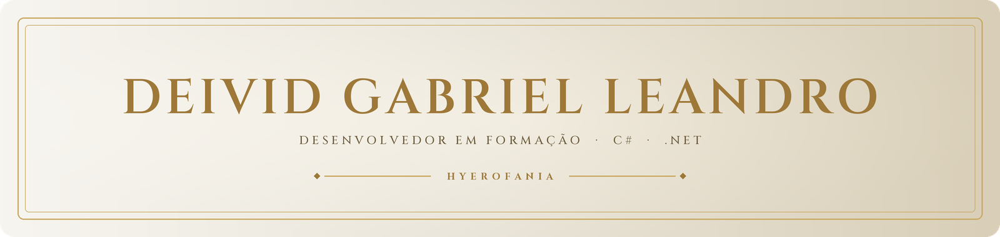
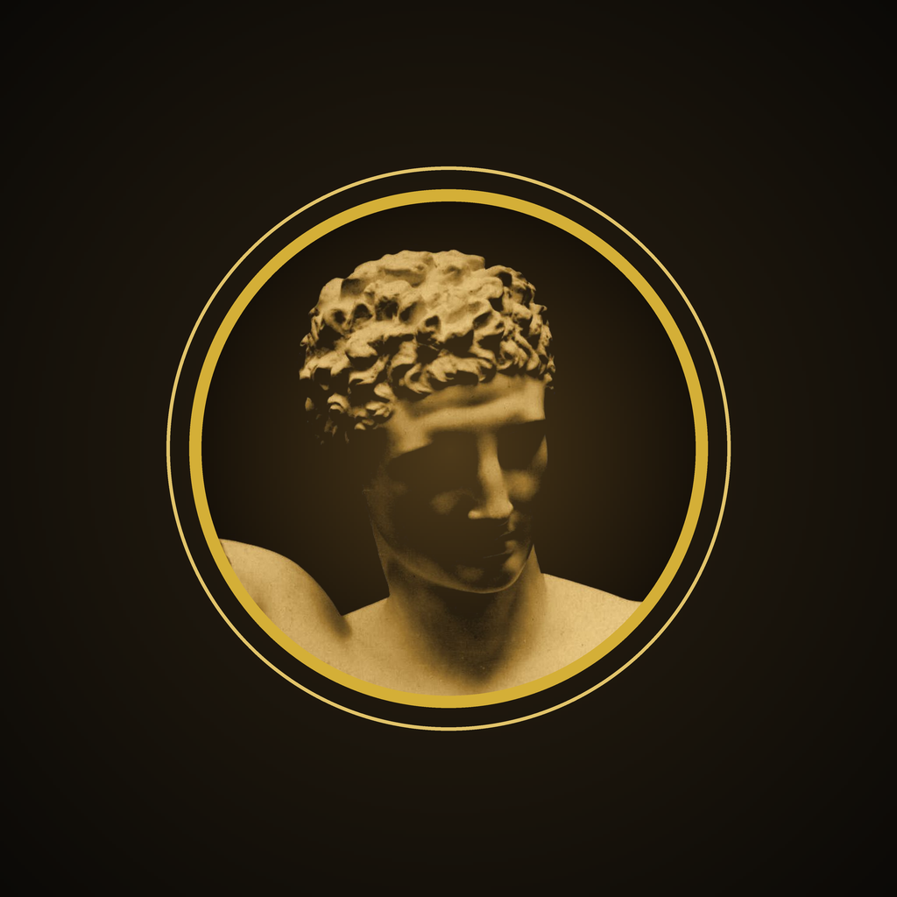
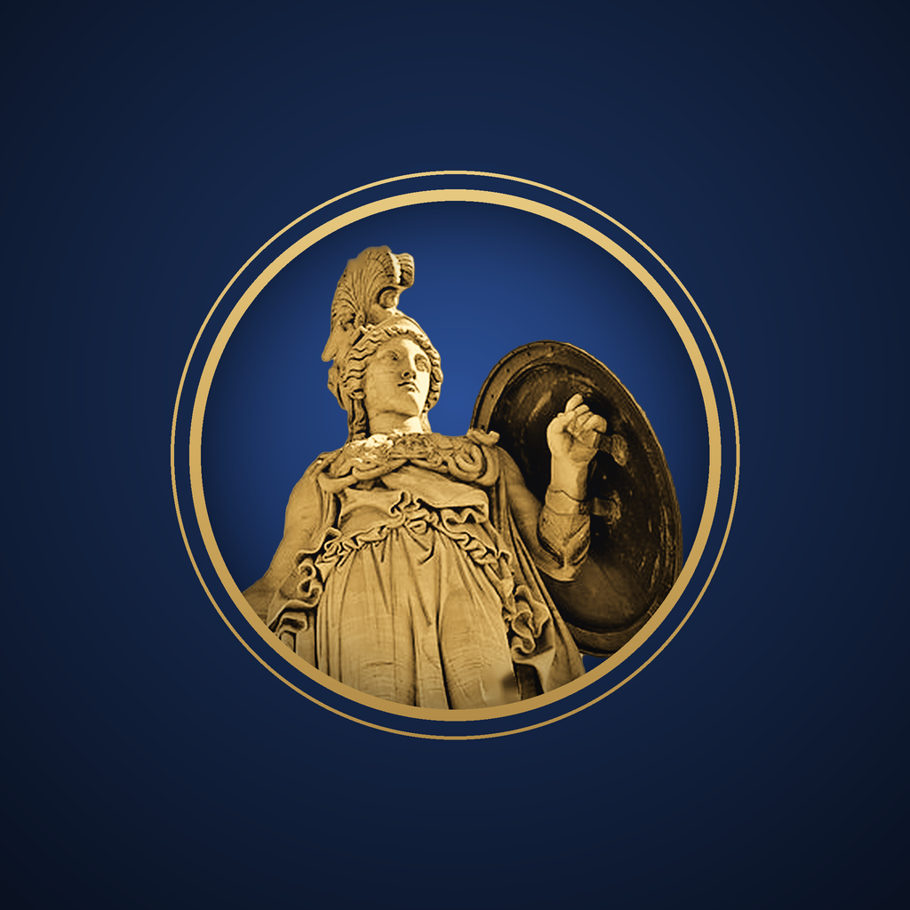
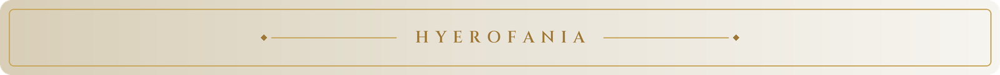

  

  Construo aplicações reais para aprender de verdade: banco de dados, interface, APIs e organização de projeto. 
  Criador da <b>Hyerofania</b>, onde cada projeto leva o nome de um deus do Olimpo.

---

## Sobre mim

- Estudante de **Programação de Jogos Digitais** no **SENAI**
- Aprendo construindo: transformo o que estudo em aplicações reais, com banco de dados, versionamento e organização de projeto
- Agora estou desenvolvendo o **Hermes**, um site full-stack com API em **ASP.NET Core**, **PostgreSQL** e **JavaScript**
- Já desenvolvi um app mobile completo com **.NET MAUI** e **SQLite**
- Tenho interesse em **desenvolvimento de software**, **cibersegurança** e projetos que unem **software e hardware**

---

## Hyerofania

> *Hierofania: a manifestação do sagrado. Do grego* hierós *(sagrado) +* phaínein *(mostrar).*

A **Hyerofania** é a marca dos meus projetos. Cada um recebe o nome de um deus da mitologia grega, de acordo com o que ele faz.

O primeiro é o **ATHENA**, com o nome da deusa da sabedoria: um app que organiza os estudos.

O segundo é o **HERMES**, com o nome do mensageiro dos deuses: um site que leva as suas mensagens até as IAs.

---

## Projetos em destaque

### HERMES · Site de chat com IA *(em desenvolvimento)*

Site full-stack para conversar com IAs num só lugar, com a sua própria chave de API e as conversas guardadas. A **v1.0 já está no ar**, com login por token JWT e chaves e mensagens criptografadas no banco. Os próximos passos são usar várias IAs ao mesmo tempo e colocar IAs diferentes para trabalhar juntas.

 

→ [**Ver o projeto**](https://github.com/DeividGabrielLeandro/Hermes) · [**Abrir o site**](https://hermes-b1r.pages.dev)

### ATHENA · Aplicativo

Aplicativo Android para organizar os estudos: cronômetro, metas, sessões com a anotação do que foi estudado e uma assistente com IA. Começou como uma [versão de terminal](https://github.com/DeividGabrielLeandro/Sistema-de-Estudo-CSharp) em C# e SQL Server, e virou o aplicativo que eu uso todo dia para contar o meu tempo de estudo.

 

→ [**Ver o projeto**](https://github.com/DeividGabrielLeandro/ATHENA-Aplicativo)

### Comunicação óptica com laser

Transforma uma mensagem em binário, envia pelo feixe de um laser controlado por um Arduino e reconstrói o texto no computador com um ESP32 e um sensor de luz.

→ [**Ver o projeto**](https://github.com/DeividGabrielLeandro/Comunicacao-Via-Laser) · [**Ver a demonstração**](https://youtu.be/H8zstGOGnCA)

---

## Experiências

### Grand Prix SENAI de Inovação · Equipe CODEX

**3º lugar na etapa regional**

Desafio de inovação proposto pela **Piracanjuba**. Em equipe, desenvolvemos uma solução para um problema real da empresa, da ideia até a apresentação. Foi uma experiência de trabalho em equipe em uma iniciativa de tecnologia, com prazo e pressão de verdade.

---

## Tecnologias

**Linguagens e plataformas**

**Bancos de dados**

**Segurança**

**Ferramentas e hospedagem**

**Aprendendo**

---

## Estatísticas

  
  

  

---

## Objetivo

Estou construindo meu portfólio para entrar na área de tecnologia. **Busco uma oportunidade de estágio remoto em desenvolvimento**, onde eu possa continuar evoluindo e transformar estudo em experiência profissional.

---

## Contato

  
  
  <!-- Quando criar o LinkedIn, troque SEU-PERFIL e tire este comentário:
  
  -->

  

